# Tuần 3: Ảo hóa, Container, Docker và Docker Compose

## Phần 1: Tổng quan về ảo hóa

### 1. Ảo hóa là gì?

**Khái niệm:** Chạy nhiều "máy tính ảo" trên 1 máy thật bằng phần mềm.

**Ví dụ:** Một căn nhà lớn (máy thật) chia thành nhiều phòng trọ (máy ảo). Mỗi phòng độc lập, có khóa riêng.

**Mục đích và vai trò trong CNTT:** Tiết kiệm phần cứng, dễ backup, dễ mở rộng.

| | Physical Machine | Virtual Machine |
|---|---|---|
| Bản chất | Máy thật | Máy "giả lập" chạy trên máy thật |
| Chi phí | Cao | Thấp |
| Tạo mới | Lâu | Vài phút |

---

### 2. Các loại ảo hóa phổ biến

| Loại | Ý nghĩa ngắn gọn |
|---|---|
| Ảo hóa máy chủ | 1 server vật lý chạy nhiều VM |
| Ảo hóa hệ điều hành | Nhiều môi trường cách ly dùng chung 1 kernel (Container) |
| Ảo hóa lưu trữ | Gom nhiều ổ đĩa thành 1 kho lưu trữ chung |
| Ảo hóa mạng | Tạo mạng ảo (VLAN, switch ảo) không cần dây thật |

**Phân biệt 3 kiểu ảo hóa:**

| Kiểu | Đặc điểm | Tốc độ |
|---|---|---|
| Full Virtualization | VM không biết mình là máy ảo, giả lập toàn bộ phần cứng | Chậm hơn |
| Para-Virtualization | VM biết mình ảo, phối hợp với hypervisor | Nhanh hơn |
| Hardware-Assisted | CPU hỗ trợ ảo hóa trực tiếp, phổ biến nhất hiện nay | Nhanh nhất |

**Kiểm tra CPU hỗ trợ ảo hóa:**

- Intel: **VT-x**, AMD: **AMD-V**
- Windows: Task Manager → Performance → CPU → xem dòng `Virtualization: Enabled`
- Linux:

```bash
lscpu | grep Virtualization
```

---

### 3. Hypervisor và các công nghệ ảo hóa

**Hypervisor là gì?** Phần mềm tạo và quản lý máy ảo, chia CPU/RAM/ổ đĩa cho từng VM.

| | Type 1 | Type 2 |
|---|---|---|
| Chạy trên | Trực tiếp phần cứng | Trên hệ điều hành có sẵn |
| Hiệu năng | Cao | Thấp hơn |
| Dùng cho | Server, doanh nghiệp | Học tập, cá nhân |
| Ví dụ | ESXi, KVM, Hyper-V, Xen, Proxmox | VirtualBox, VMware Workstation |

**Mẹo nhớ:** Type 1 = "chạy trần" trên phần cứng. Type 2 = "chạy nhờ" Windows/Linux.

**Các công nghệ phổ biến:** VMware ESXi, KVM, Hyper-V, Xen, Proxmox, VirtualBox.

# Phần 2: Virtual Machine

## 4. Tổng quan về Virtual Machine

**Khái niệm:** VM là máy tính ảo chạy bằng phần mềm, có CPU, RAM, ổ đĩa, card mạng riêng như máy thật.

**Kiến trúc 1 máy ảo (từ dưới lên):**

```
Phần cứng thật → Host OS → Hypervisor → VM (Guest OS → Ứng dụng)
```

| | Host OS | Guest OS |
|---|---|---|
| Là gì | HĐH của máy thật | HĐH cài bên trong VM |
| Ví dụ | Windows 11 | Ubuntu Server chạy trong VirtualBox |

### Các thành phần được ảo hóa

**CPU (vCPU):** Nhân CPU ảo, 1 vCPU được hypervisor "mượn" từ core thật.

**Memory (RAM):** Hypervisor cắt một phần RAM thật cấp cho VM.

**Disk (ổ đĩa ảo):** Thực chất là 1 file nằm trên máy thật.

| Định dạng | Dùng bởi |
|---|---|
| vmdk | VMware |
| qcow2 | KVM/QEMU |
| vdi | VirtualBox |

| Provisioning | Ý nghĩa | Ví dụ |
|---|---|---|
| Thin | Cấp 100GB nhưng chỉ chiếm đúng dung lượng đã dùng | Thuê kho 100m², trả tiền theo phần chứa hàng |
| Thick | Chiếm đủ 100GB ngay từ đầu | Thuê kho 100m², trả đủ dù để trống |

**Network (vNIC):**

| Chế độ | Ý nghĩa | Ví dụ |
|---|---|---|
| NAT | VM ra Internet qua máy host, bên ngoài không vào được VM | Ở trong nhà, chỉ đi ra ngoài được |
| Bridged | VM như 1 máy thật trong mạng LAN, có IP riêng | Có số nhà riêng |
| Host-only | VM chỉ nói chuyện với host, không ra Internet | Mạng nội bộ khép kín |

### Chia sẻ tài nguyên giữa các VM

| Cơ chế | Ý nghĩa |
|---|---|
| Overcommit | Cấp tổng RAM/CPU cho các VM vượt quá máy thật (vì ít khi dùng hết cùng lúc) |
| Reservation | Đảm bảo VM luôn có tối thiểu X tài nguyên |
| Limit | Giới hạn tối đa VM được dùng |
| Share | Độ ưu tiên khi tranh giành tài nguyên (share cao → được chia nhiều hơn) |

---

## 5. Cơ chế hoạt động của máy ảo

**Nguyên lý:** Guest OS tưởng mình điều khiển phần cứng, nhưng thực tế hypervisor là người kiểm soát.

**Hardware-Assisted Virtualization:**

- **Root mode:** chế độ của hypervisor (quyền cao nhất)
- **Non-root mode:** chế độ của Guest OS
- **VM Exit:** Guest cần làm việc đặc quyền → CPU chuyển quyền về hypervisor
- **VM Entry:** Hypervisor xử lý xong → trả quyền lại cho Guest

**Ảo hóa CPU:** Hypervisor lập lịch vCPU lên các core vật lý, lần lượt thay phiên nhau.

**Ảo hóa bộ nhớ:**

```
Guest Virtual → Guest Physical → Host Physical
```

CPU hỗ trợ chuyển đổi nhanh bằng **EPT** (Intel) / **NPT** (AMD).

**Ảo hóa I/O:**

| Cách | Đặc điểm |
|---|---|
| Emulation | Giả lập thiết bị cũ, chạy chậm |
| Para-virtualization (virtio) | Driver đặc biệt, nhanh hơn |
| PCI Passthrough | Gắn thẳng thiết bị thật (VD: card GPU) vào VM |
| SR-IOV | 1 card mạng thật chia thành nhiều card ảo |

**Mô hình KVM + QEMU + libvirt:**

| Thành phần | Vai trò |
|---|---|
| KVM | Module trong nhân Linux, biến Linux thành hypervisor |
| QEMU | Giả lập thiết bị phần cứng cho VM |
| libvirt | Công cụ quản lý (`virsh`, `virt-manager`) |

---

## 6. Vòng đời và quản lý VM

**Các trạng thái:**

```
Created → Running ⇄ Paused → Stopped
```

- **Created:** vừa tạo, chưa chạy
- **Running:** đang chạy
- **Paused:** tạm dừng, giữ nguyên RAM
- **Stopped:** đã tắt

**Thao tác cơ bản:** Tạo → Khởi động → Tắt → Xóa.

**Điều chỉnh tài nguyên:** Tăng/giảm CPU, RAM, Disk khi cần.

| Khái niệm | Ý nghĩa | Ví dụ |
|---|---|---|
| Snapshot | Chụp lại trạng thái VM để quay lui | Điểm save game |
| Clone | Sao chép ra VM mới | Photocopy |
| Template | VM mẫu để tạo nhiều VM giống nhau | Khuôn bánh |
| Backup/Restore | Sao lưu và khôi phục VM | Sao lưu dữ liệu |

**Nâng cao:**

- **Live Migration:** Chuyển VM đang chạy sang server khác mà không bị gián đoạn.
- **High Availability (HA):** Server hỏng → VM tự khởi động lại trên server khác.

---

## 7. Thực hành quản lý VM

**1. Kiểm tra CPU hỗ trợ ảo hóa, cài VirtualBox hoặc KVM:**

```bash
lscpu | grep Virtualization
sudo apt install virtualbox      # hoặc: sudo apt install qemu-kvm libvirt-daemon-system
```
>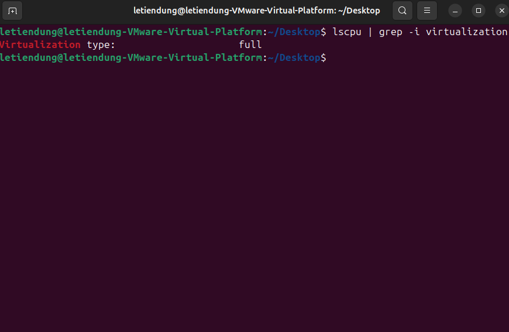
>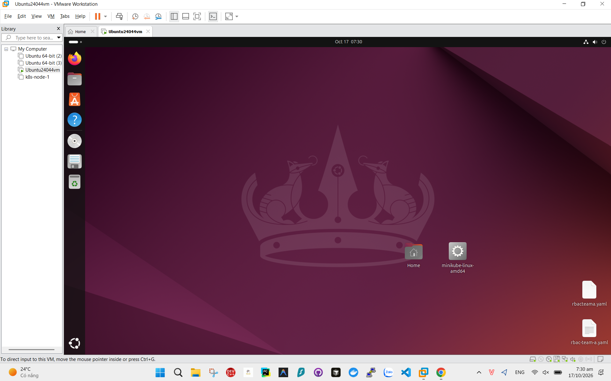
>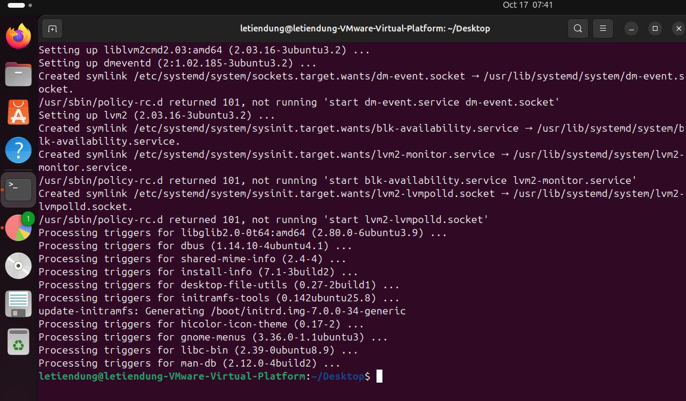
**2. Tạo VM Ubuntu Server và quan sát tài nguyên ảo:**

```bash
lscpu      # xem số vCPU
free -h    # xem RAM
lsblk      # xem ổ đĩa
```
>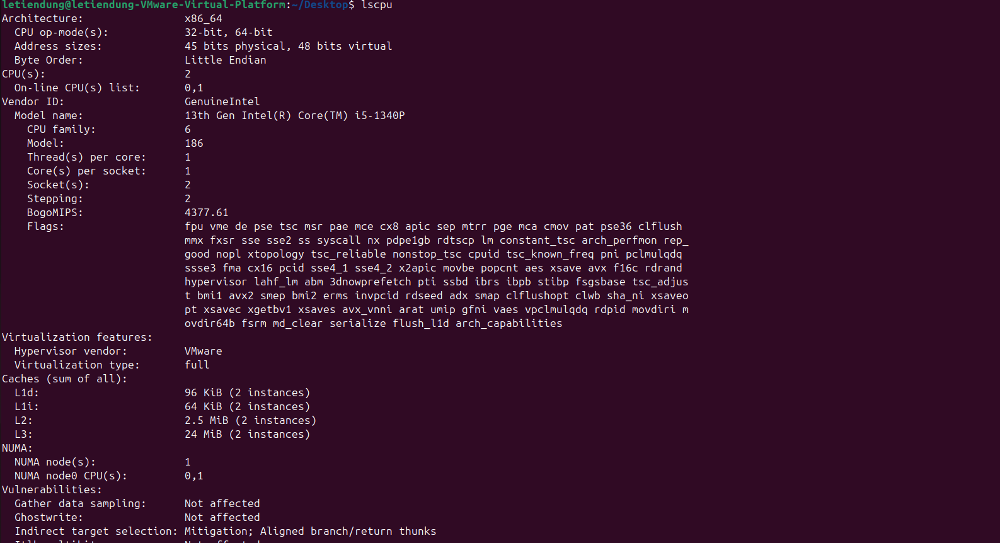
>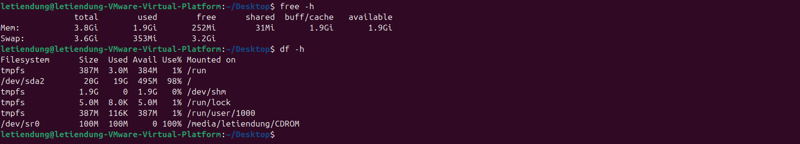
**3. Snapshot và Revert:** Chụp snapshot → thử nghiệm làm hỏng gì đó → Revert để quay lại.

**4. Clone VM:** Chuột phải VM → Clone → tạo bản sao.

**5. Điều chỉnh CPU, RAM, Disk:** Tắt VM → vào Settings → tăng/giảm thông số → bật lại.

**6. Export/Backup, xóa và Restore:** Export VM ra file (VirtualBox: `.ova`) → xóa VM → Import lại file để khôi phục.


# Phần 3: Tổng quan về Container

## 8. Container là gì?

**Khái niệm:** Container là cách đóng gói ứng dụng cùng thư viện, cấu hình cần thiết vào một gói cô lập. Quá trình này gọi là **Containerization**.

**Ví dụ:** Giống hộp cơm dã ngoại: mọi thứ cần ăn đã đóng sẵn trong hộp, mang đi đâu cũng dùng được.

**Mục đích:** Chạy ứng dụng giống nhau ở mọi nơi (máy dev, server test, production), khởi động nhanh, nhẹ.

**Container vs Virtual Machine:**

| | Container | Virtual Machine |
|---|---|---|
| Hệ điều hành | Dùng chung kernel của host | Mỗi VM có Guest OS riêng |
| Dung lượng | Nhẹ (MB) | Nặng (GB) |
| Khởi động | Vài giây | Vài phút |
| Cách ly | Yếu hơn | Mạnh hơn |

**Khi nên dùng VM thay vì Container:**
- Cần chạy hệ điều hành khác với host (VD: Windows trên Linux)
- Cần cách ly bảo mật rất cao
- Cần kernel riêng hoặc driver đặc biệt
>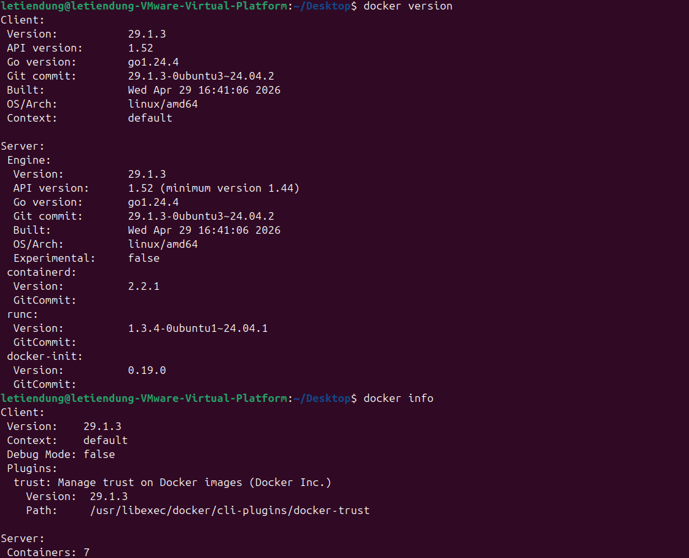
---

## 9. Cơ chế hoạt động của Container trên Linux

**Container dùng chung Linux Kernel:** Không có Guest OS, container chỉ là tiến trình (process) được "khoanh vùng" lại.

**Namespace:** Tạo ra "góc nhìn riêng" cho từng container.

| Namespace | Cô lập gì | Ví dụ dễ hiểu |
|---|---|---|
| pid | Tiến trình | Trong container, `ps` chỉ thấy tiến trình của nó |
| net | Mạng | Có card mạng và IP riêng |
| mnt | Hệ thống file | Có cây thư mục riêng |
| uts | Hostname | Có tên máy riêng |
| ipc | Giao tiếp tiến trình | Bộ nhớ dùng chung riêng |
| user | Người dùng | `root` trong container không phải `root` trên host |

**Control Groups (cgroups):** Giới hạn tài nguyên.

- Ví dụ: "Container này chỉ được dùng tối đa 1 CPU và 512MB RAM".

**Union Filesystem / OverlayFS:** Nhiều lớp file xếp chồng lên nhau.

- **Copy-on-Write:** Khi sửa file từ lớp gốc, chỉ sao chép file đó lên lớp mới, không sao chép cả image.

```
[Lớp ứng dụng]   ← ghi thay đổi ở đây
[Lớp thư viện]   ← chỉ đọc
[Lớp hệ điều hành cơ bản] ← chỉ đọc, dùng chung
```

**Container Image vs Container Runtime:**

| | Container Image | Container Runtime |
|---|---|---|
| Là gì | Bản "khuôn" chỉ đọc | Tiến trình đang chạy từ khuôn |
| Ví dụ | Class trong lập trình | Object được tạo từ class |

**Chuẩn OCI (Open Container Initiative):** Quy định chung về định dạng image (Image Spec) và cách chạy container (Runtime Spec), giúp các công cụ khác nhau hoạt động với nhau.

---

# Phần 4: Docker cơ bản

## 10. Tổng quan về Docker

**Docker là gì?** Nền tảng giúp tạo, chạy và chia sẻ container dễ dàng.

**Tại sao cần Docker?** Trước đây phải tự cấu hình namespace, cgroups bằng tay rất phức tạp. Docker gói gọn tất cả thành vài lệnh đơn giản.

**Các thành phần chính:**

| Thành phần | Vai trò |
|---|---|
| Docker Engine | Lõi chạy container (daemon `dockerd`) |
| Docker CLI | Công cụ dòng lệnh `docker` |
| Docker Desktop | Ứng dụng có giao diện, dùng trên Windows/macOS |
| Docker Registry | Kho lưu trữ image (VD: Docker Hub) |

**Docker CE vs Docker EE:** CE là bản miễn phí cho cộng đồng; EE là bản thương mại có hỗ trợ cho doanh nghiệp.

**3 khái niệm cốt lõi:**

| Khái niệm | Ví dụ |
|---|---|
| Image | Khuôn bánh |
| Container | Bánh đã nướng (chạy từ khuôn) |
| Registry | Tiệm bán khuôn bánh (Docker Hub) |

**Quy trình cơ bản:** `Build → Ship → Run`

- **Build:** tạo image từ Dockerfile
- **Ship:** đẩy image lên Registry
- **Run:** kéo image về và chạy container

---

## 11. Cài đặt và cấu hình Docker trên Linux

**Cài Docker Engine trên Ubuntu:**

```bash
sudo apt update
sudo apt install docker.io
```
>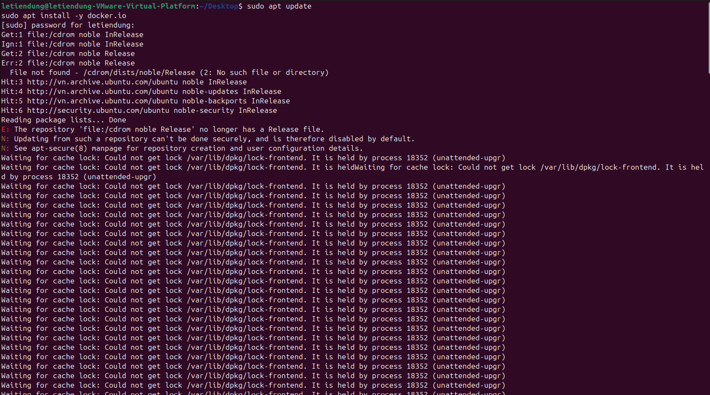
**Chạy Docker không cần sudo:**

```bash
sudo usermod -aG docker $USER
# Đăng xuất rồi đăng nhập lại để có hiệu lực
```
>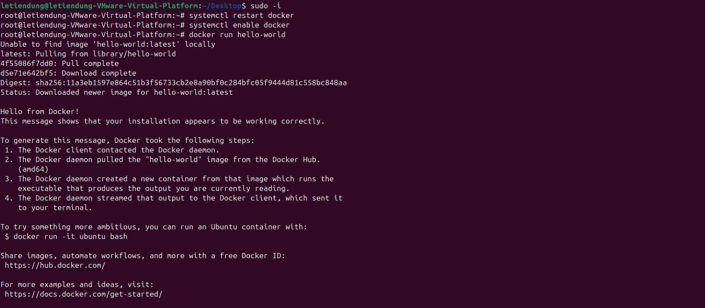
> Lưu ý bảo mật: người trong nhóm `docker` có quyền tương đương root trên máy.

**Kiểm tra Docker:**

```bash
docker version
docker info
```
>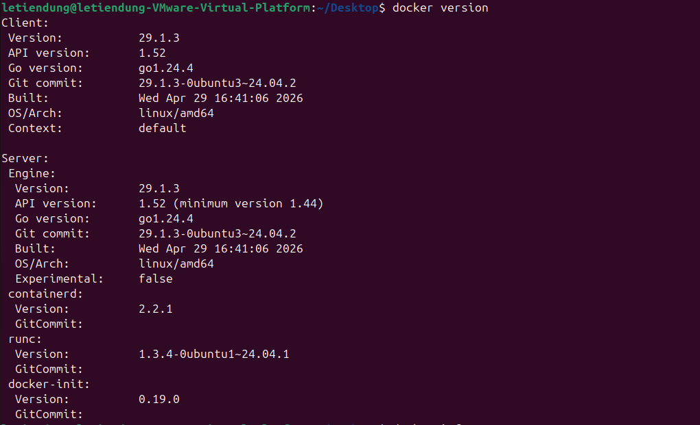
>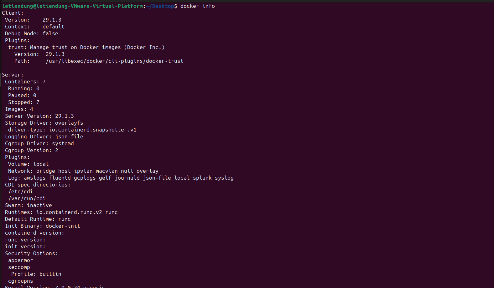
**Quản lý dịch vụ với systemctl:**

```bash
sudo systemctl start docker
sudo systemctl enable docker    
sudo systemctl status docker
```

**Cấu hình Docker Proxy (khi sau mạng công ty/có proxy):**

- **Proxy cho Docker Daemon:** tạo file `/etc/systemd/system/docker.service.d/http-proxy.conf`
- **Proxy cho Docker Client và Container:** cấu hình trong `~/.docker/config.json`
>
>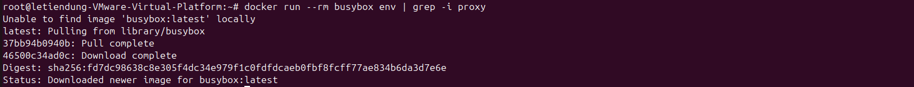
**Cấu hình Docker Registry:**

- **Registry nội bộ:** đặt địa chỉ registry riêng của công ty
- **Chứng chỉ CA tin cậy:** đặt CA vào `/etc/docker/certs.d/<registry>/`
- **insecure-registries:** thêm vào `/etc/docker/daemon.json` (chỉ dùng cho môi trường thử nghiệm)

```json
{
  "insecure-registries": ["192.168.1.10:5000"]
}
```
>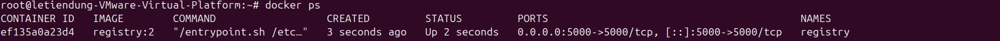
>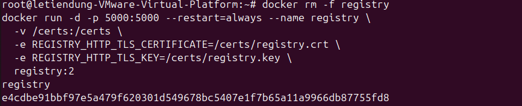
**insecure-registries trong daemon.json**
>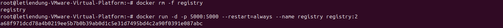 
Chạy lại resgitry
>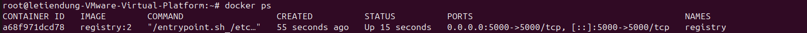
**Chạy container đầu tiên:**

```bash
docker run hello-world
```
>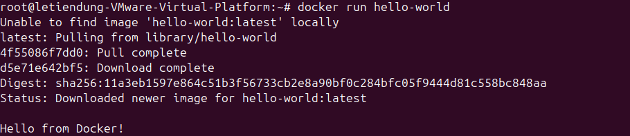
---

## 12. Các câu lệnh Docker cơ bản

| Lệnh | Ý nghĩa |
|---|---|
| `docker pull <image>` | Tải image về máy |
| `docker images` | Liệt kê image |
| `docker run <image>` | Tạo và chạy container |
| `docker ps` | Xem container đang chạy |
| `docker ps -a` | Xem tất cả container (kể cả đã dừng) |
| `docker stop / start / restart <tên>` | Dừng / khởi động / khởi động lại container |
| `docker rm <tên>` | Xóa container |
| `docker rmi <image>` | Xóa image |
| `docker logs <tên>` | Xem log |
| `docker exec -it <tên> bash` | Vào bên trong container để chạy lệnh |
| `docker inspect <tên>` | Xem thông tin chi tiết (JSON) |
| `docker stats` | Theo dõi tài nguyên container theo thời gian thực |
| `docker cp` | Sao chép file giữa host và container |
| `docker top` | Xem tiến trình đang chạy trong container |
| `docker diff` | Xem file nào đã thay đổi so với image gốc |

**Các option hay dùng với `docker run`:**

| Option | Ý nghĩa |
|---|---|
| `-d` | Chạy nền (detached) |
| `-it` | Chạy tương tác với terminal |
| `--name` | Đặt tên cho container |
| `-p 8080:80` | Ánh xạ cổng: host 8080 → container 80 |
| `-v` | Gắn thư mục/volume |
| `-e` | Đặt biến môi trường |
| `--rm` | Tự xóa container khi dừng |

**Ví dụ tổng hợp:**

```bash
docker run -d --name web -p 8080:80 nginx
docker ps
docker logs web
docker exec -it web bash
docker stop web && docker rm web
```

**Restart policy:** tự khởi động lại container khi lỗi hoặc khi máy khởi động lại.

```bash
docker run -d --restart unless-stopped nginx
```

**Giới hạn tài nguyên:**

```bash
docker run -d --memory="512m" --cpus="1" nginx
```
# Phần 5: Docker Image và Dockerfile

## 13. Docker Image là gì?

**Khái niệm:** Image là bản "khuôn" chỉ đọc chứa sẵn ứng dụng và mọi thứ cần để chạy. Container được tạo ra từ image.

**Ví dụ:** Image giống file cài đặt, container giống chương trình đang chạy từ file đó.

| | Image | Container |
|---|---|---|
| Trạng thái | Chỉ đọc, tĩnh | Đang chạy, có thể ghi |
| Số lượng | 1 image | Nhiều container từ 1 image |

**Cấu trúc Image Layers:** Image gồm nhiều lớp xếp chồng, mỗi lệnh trong Dockerfile tạo ra một lớp.

```bash
docker history nginx    # xem các lớp của image
```

**Image Tag và Digest:**

| | Tag | Digest |
|---|---|---|
| Là gì | Tên phiên bản, dễ đổi | Mã SHA256 duy nhất, không đổi |
| Ví dụ | `nginx:1.25` | `nginx@sha256:...` |

**Registry:**

- **Docker Hub:** kho công khai
- **Private Registry:** kho riêng của công ty, bảo mật hơn

**Các lệnh quản lý image:**

```bash
docker pull nginx:1.25                  # tải image
docker tag myapp:1.0 user/myapp:1.0     # đặt tên/tag mới
docker push user/myapp:1.0              # đẩy lên registry
```

**Quy tắc đặt tên phiên bản (Semantic Versioning):** `MAJOR.MINOR.PATCH`

- `2.1.0` → `2.1.1`: sửa lỗi nhỏ
- `2.1.0` → `2.2.0`: thêm tính năng mới
- `2.1.0` → `3.0.0`: thay đổi lớn, không tương thích ngược

**Tránh dùng tag `latest`:** nó không cho biết phiên bản cụ thể, dễ gây lỗi khi triển khai.

**Lưu và nạp image offline (khi không có mạng):**

```bash
docker save -o myapp.tar user/myapp:1.0    # xuất ra file
docker load -i myapp.tar                   # nạp lại trên máy khác
```

---

## 14. Xây dựng Docker Image bằng Dockerfile

**Dockerfile là gì?** File văn bản chứa các lệnh để tự động tạo image, giống công thức nấu ăn.

**Các chỉ thị cơ bản:**

| Chỉ thị | Ý nghĩa |
|---|---|
| `FROM` | Image nền để bắt đầu (VD: `FROM python:3.11`) |
| `RUN` | Chạy lệnh khi build (VD: cài thư viện) |
| `COPY` | Sao chép file từ máy vào image |
| `ADD` | Giống COPY, nhưng có thể tải URL và giải nén (nên ưu tiên COPY) |
| `WORKDIR` | Đặt thư mục làm việc |
| `ENV` | Đặt biến môi trường |
| `ARG` | Biến chỉ dùng lúc build |
| `EXPOSE` | Khai báo cổng ứng dụng dùng (chỉ mang tính ghi chú) |
| `CMD` | Lệnh chạy mặc định khi container khởi động |
| `ENTRYPOINT` | Lệnh chính cố định của container |
| `USER` | Chọn người dùng chạy ứng dụng |
| `HEALTHCHECK` | Kiểm tra container có còn khỏe không |
| `LABEL` | Gắn thông tin mô tả (tác giả, phiên bản) |
| `VOLUME` | Khai báo thư mục lưu dữ liệu lâu dài |

**Ví dụ Dockerfile đơn giản:**

```dockerfile
FROM python:3.11-slim
WORKDIR /app
COPY . .
RUN pip install -r requirements.txt
EXPOSE 5000
CMD ["python", "app.py"]
```

**Build image:**

```bash
docker build -t myapp:1.0 .
```

**Sử dụng .dockerignore:** liệt kê file/thư mục không đưa vào image (VD: `.git`, `node_modules`, `*.log`), giúp build nhanh và image nhẹ hơn.

```
.git
node_modules
*.log
```

**CMD và ENTRYPOINT:**

| | CMD | ENTRYPOINT |
|---|---|---|
| Tính chất | Dễ bị ghi đè khi `docker run` | Cố định, lệnh truyền thêm được nối vào |
| Ví dụ | `CMD ["python", "app.py"]` | `ENTRYPOINT ["python"]` |

**Exec form vs Shell form:**

```dockerfile
CMD ["python", "app.py"]    # exec form (khuyên dùng): không qua shell, nhận tín hiệu dừng tốt
CMD python app.py           # shell form: chạy qua /bin/sh
```

**Multi-stage Build:** Dùng nhiều `FROM` trong một Dockerfile. Giai đoạn đầu để build (cần compiler, công cụ), giai đoạn cuối chỉ copy kết quả cần thiết.

```dockerfile
# Giai đoạn 1: build
FROM golang:1.22 AS build
WORKDIR /src
COPY . .
RUN go build -o app

# Giai đoạn 2: image nhỏ gọn để chạy
FROM alpine:3.19
COPY --from=build /src/app /app
CMD ["/app"]
```

> Ví dụ: như đầu bếp nấu trong bếp lớn, nhưng chỉ mang món ăn đã xong ra bàn, không mang theo dụng cụ nấu.

**Tối ưu kích thước và Build Cache:**

- Đặt lệnh ít thay đổi (cài thư viện) lên trước, lệnh hay thay đổi (copy code) xuống sau để tận dụng cache.
- Dùng image nền nhỏ (`-slim`, `alpine`).
- Gom nhiều lệnh `RUN` lại bằng `&&` để giảm số lớp.

**Thực hành tốt:**

- Chạy bằng user thường, không dùng root:

```dockerfile
RUN useradd -m appuser
USER appuser
```

- Ghim phiên bản base image cụ thể (`python:3.11-slim`), tránh `latest`.

---

## 15. Thực hành Build và Push Docker Image

**Các bước:**

1. Tạo ứng dụng web đơn giản (VD: `app.py` chạy Flask hoặc Node.js)
2. Viết `Dockerfile` cho ứng dụng
3. Build image: `docker build -t myapp:1.0 .`
4. Chạy thử: `docker run -d -p 5000:5000 myapp:1.0`
5. Gắn tag cho image:
>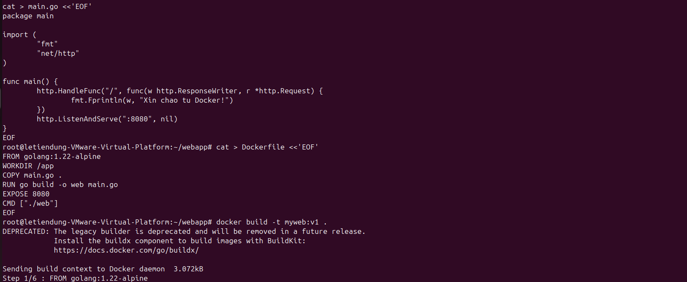
>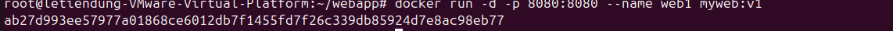
>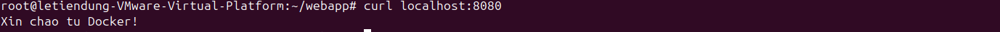
```bash
docker tag myapp:1.0 <username>/myapp:1.0
```
>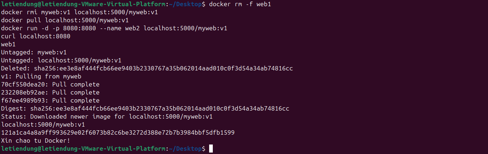
Image nằm trên registry
6. Đăng nhập Docker Hub hoặc Private Registry:

```bash
docker login
```

7. Push image lên registry:

```bash
docker push <username>/myapp:1.0
```
>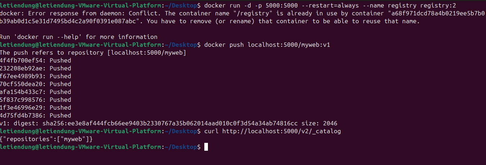
8. Trên máy khác, pull về và chạy thử:

```bash
docker pull <username>/myapp:1.0
docker run -d -p 5000:5000 <username>/myapp:1.0
```
>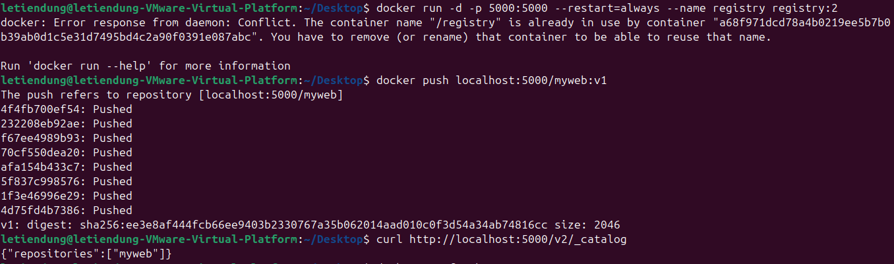
**Mở rộng:** Viết lại Dockerfile dùng Multi-stage Build, rồi so sánh kích thước hai image:

```bash
docker images myapp
```

Thường bản Multi-stage nhỏ hơn đáng kể so với bản thường.
# Phần 6: Kiến trúc và quản lý Docker

## 16. Kiến trúc Docker Engine

**Mô hình Client – Server:**

```
Docker CLI (client) → Docker API → Docker Daemon (dockerd) → containerd → runc → Container
```

**Các thành phần:**

| Thành phần | Vai trò | Ví dụ dễ hiểu |
|---|---|---|
| Docker CLI | Lệnh bạn gõ (`docker run`...) | Remote điều khiển |
| Docker API | Giao tiếp giữa CLI và daemon | Dây truyền tín hiệu |
| Docker Daemon (`dockerd`) | Nhận lệnh, quản lý image, container, network | Quản lý nhà hàng |
| containerd | Quản lý vòng đời container, pull/lưu image | Trưởng bếp |
| containerd-shim | Giữ container chạy khi containerd khởi động lại | Người giữ cửa |
| runc | Tạo container thật (namespace, cgroups) | Đầu bếp trực tiếp nấu |

**Cấu hình daemon:** file `/etc/docker/daemon.json`

```json
{
  "log-driver": "json-file",
  "insecure-registries": ["192.168.1.10:5000"]
}
```

**Quy trình từ `docker run` đến khi container chạy:**

1. CLI gửi yêu cầu tới daemon qua API
2. Daemon kiểm tra image, nếu chưa có thì pull về
3. containerd chuẩn bị image và tạo bundle
4. runc tạo namespace, cgroups, mount file system
5. Container khởi động và chạy tiến trình chính

**Quan hệ giữa Docker Engine và Container Runtime:** Docker Engine là bộ công cụ hoàn chỉnh; containerd và runc là container runtime nằm bên dưới, thực sự chạy container.

---

## 17. Docker Networking

**Tổng quan:** Docker tạo mạng ảo để các container giao tiếp với nhau và với bên ngoài.

| Thành phần | Vai trò |
|---|---|
| veth | Cặp card mạng ảo nối container với mạng host |
| docker0 | Bridge mạng mặc định nối các container |
| iptables | Quy tắc định tuyến, NAT, mở cổng |

**Các loại Docker Network:**

| Loại | Đặc điểm | Ví dụ dùng |
|---|---|---|
| Bridge (default) | Container có IP riêng trong mạng nội bộ | Chạy ứng dụng đơn lẻ |
| Bridge (user-defined) | Có DNS, container gọi nhau bằng tên | Web + database |
| Host | Container dùng chung mạng với host | Cần hiệu năng mạng cao |
| None | Không có mạng | Container cô lập hoàn toàn |
| Overlay | Nối container trên nhiều máy | Docker Swarm, cụm nhiều server |
| Macvlan | Container có IP như thiết bị vật lý trong LAN | Cần IP trực tiếp trong mạng |

**Port Mapping với `-p`:**

```bash
docker run -d -p 8080:80 nginx    # truy cập host:8080 → container:80
```

**DNS và giao tiếp giữa các container:** Trong user-defined bridge, container gọi nhau bằng **tên container**.

**Tạo network và kết nối:**

```bash
docker network create mynet
docker run -d --name db --network mynet -e POSTGRES_PASSWORD=123 postgres
docker run -d --name app --network mynet myapp
# Trong container "app", kết nối tới database bằng tên "db"
```

**Thực hành:** Tạo 2 container trong cùng network, dùng `docker exec` vào một container và `ping` tên container còn lại.

```bash
docker exec -it app ping db
```

---

## 18. Docker Storage và Volume

**Dữ liệu trong container được lưu thế nào?**

Container có tầng ghi (writable layer) riêng. Dữ liệu ở đây **mất khi xóa container**.

**Ephemeral Storage:** Lưu trữ tạm thời, sống cùng vòng đời container.

> Ví dụ: ghi chú trên bảng trắng, xóa container là xóa luôn ghi chú.

**3 cách lưu dữ liệu bền vững:**

| Loại | Đặc điểm | Ví dụ |
|---|---|---|
| Docker Volume | Docker quản lý, khuyên dùng | `-v mydata:/var/lib/mysql` |
| Bind Mount | Gắn trực tiếp thư mục của host | `-v /home/user/data:/data` |
| tmpfs Mount | Lưu trong RAM, mất khi tắt | `--tmpfs /tmp` |

**Các lệnh quản lý volume:**

```bash
docker volume create mydata       # tạo volume
docker volume ls                  # liệt kê
docker volume inspect mydata      # xem chi tiết
docker volume rm mydata           # xóa
```

**Mount thư mục từ host vào container:**

```bash
docker run -d -v /home/user/web:/usr/share/nginx/html nginx
```

**Persistent Data, backup và restore volume:**

Backup volume ra file tar:

```bash
docker run --rm -v mydata:/data -v $(pwd):/backup alpine \
  tar czf /backup/mydata.tar.gz -C /data .
```

Restore từ file tar:

```bash
docker run --rm -v mydata:/data -v $(pwd):/backup alpine \
  tar xzf /backup/mydata.tar.gz -C /data
```

**Thực hành: chạy MySQL với Docker Volume**

```bash
docker volume create mysql-data
docker run -d --name mysql \
  -e MYSQL_ROOT_PASSWORD=123456 \
  -v mysql-data:/var/lib/mysql \
  mysql:8.0
```

Xóa container rồi tạo lại, dữ liệu vẫn còn nguyên nhờ volume:

```bash
docker rm -f mysql
docker run -d --name mysql -e MYSQL_ROOT_PASSWORD=123456 \
  -v mysql-data:/var/lib/mysql mysql:8.0
```
# Phần 7: Docker Compose

## 19. Tổng quan về Docker Compose

**Docker Compose là gì?** Công cụ dùng một file YAML để định nghĩa và chạy nhiều container cùng lúc.

**Tại sao cần Docker Compose?** Ứng dụng thường gồm nhiều thành phần (web, database, cache). Nếu chạy bằng lệnh `docker run` riêng lẻ thì rất dài và dễ sai. Compose gom tất cả vào một file.

> Ví dụ: thay vì gọi từng nhân viên làm việc, bạn đưa một bản kế hoạch, cả đội tự làm theo.

**Phân biệt Docker CLI và Docker Compose:**

| | Docker CLI | Docker Compose |
|---|---|---|
| Làm việc với | Từng container | Cả nhóm container (một ứng dụng) |
| Cấu hình | Tham số dòng lệnh | File `compose.yaml` |

**Docker Compose V2:** Dùng lệnh `docker compose` (có khoảng trắng), thay thế cho `docker-compose` cũ.

**Cấu trúc file `compose.yaml`:**

```yaml
services:
  web:
    image: nginx
    ports:
      - "8080:80"
  db:
    image: postgres:16
    environment:
      POSTGRES_PASSWORD: 123456

networks:
  mynet:

volumes:
  dbdata:
```

**3 thành phần chính:**

| Thành phần | Vai trò |
|---|---|
| Services | Các container của ứng dụng (web, db...) |
| Networks | Mạng nội bộ nối các service |
| Volumes | Nơi lưu dữ liệu bền vững |

---

## 20. Viết và quản lý Docker Compose

**Khai báo nhiều service:** Mỗi service là một container, khai báo dưới mục `services`.

**Cấu hình Image và Build:**

```yaml
services:
  web:
    build: .            # build từ Dockerfile trong thư mục hiện tại
    ports:
      - "5000:5000"
  db:
    image: mysql:8.0    # dùng image có sẵn
```

**Environment Variables và file `.env`:**

Tạo file `.env` cạnh `compose.yaml`:

```env
MYSQL_ROOT_PASSWORD=123456
MYSQL_DATABASE=appdb
```

Dùng trong `compose.yaml`:

```yaml
services:
  db:
    image: mysql:8.0
    environment:
      MYSQL_ROOT_PASSWORD: ${MYSQL_ROOT_PASSWORD}
      MYSQL_DATABASE: ${MYSQL_DATABASE}
```

**Volume và Network trong Compose:**

```yaml
services:
  db:
    image: mysql:8.0
    volumes:
      - mysql-data:/var/lib/mysql
    networks:
      - backend

volumes:
  mysql-data:

networks:
  backend:
```

**depends_on và healthcheck:**

- `depends_on`: đảm bảo service này khởi động sau service kia
- `healthcheck`: kiểm tra service đã thực sự sẵn sàng chưa (không chỉ đang chạy)

```yaml
services:
  web:
    depends_on:
      db:
        condition: service_healthy
  db:
    image: mysql:8.0
    healthcheck:
      test: ["CMD", "mysqladmin", "ping", "-h", "localhost"]
      interval: 10s
      retries: 5
```

**Các lệnh thường dùng:**

| Lệnh | Ý nghĩa |
|---|---|
| `docker compose up -d` | Tạo và chạy tất cả service ở chế độ nền |
| `docker compose down` | Dừng và xóa container, network |
| `docker compose ps` | Xem trạng thái các service |
| `docker compose logs -f` | Xem log (`-f` để theo dõi liên tục) |
| `docker compose exec web bash` | Vào bên trong một service |
| `docker compose build` | Build lại image |
| `docker compose config` | Kiểm tra và in cấu hình sau khi ghép |
| `docker compose stop / start / restart` | Dừng / khởi động / khởi động lại service |

**Scale service:** chạy nhiều bản sao của một service.

```bash
docker compose up -d --scale web=3
```

> Lưu ý: khi scale, cần bỏ `ports` cố định hoặc dùng load balancer, vì nhiều container không thể cùng chiếm một cổng host.

**File `compose.override.yaml`:** file ghi đè tự động, thường dùng để thêm cấu hình cho môi trường phát triển mà không sửa file chính.

```yaml
# compose.override.yaml
services:
  web:
    volumes:
      - ./src:/app/src    # mount code để sửa là thấy ngay
```

---

## 21. Thực hành triển khai ứng dụng bằng Docker Compose

**Mục tiêu:** Triển khai ứng dụng gồm Web Application và MySQL.

**Cấu trúc thư mục:**

```
myapp/
├── app.py
├── requirements.txt
├── Dockerfile
├── compose.yaml
└── .env
```

**1. Dockerfile cho Web Application:**

```dockerfile
FROM python:3.11-slim
WORKDIR /app
COPY requirements.txt .
RUN pip install -r requirements.txt
COPY . .
EXPOSE 5000
CMD ["python", "app.py"]
```
>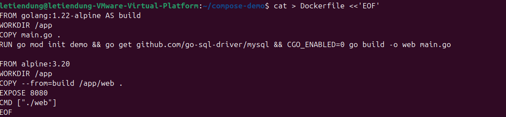
**2. File `.env`:**

```env
MYSQL_ROOT_PASSWORD=123456
MYSQL_DATABASE=appdb
```

**3. File `compose.yaml`:**

```yaml
services:
  web:
    build: .
    ports:
      - "5000:5000"
    environment:
      DB_HOST: db
      DB_NAME: ${MYSQL_DATABASE}
      DB_PASSWORD: ${MYSQL_ROOT_PASSWORD}
    depends_on:
      db:
        condition: service_healthy
    networks:
      - backend

  db:
    image: mysql:8.0
    environment:
      MYSQL_ROOT_PASSWORD: ${MYSQL_ROOT_PASSWORD}
      MYSQL_DATABASE: ${MYSQL_DATABASE}
    volumes:
      - mysql-data:/var/lib/mysql
    healthcheck:
      test: ["CMD", "mysqladmin", "ping", "-h", "localhost"]
      interval: 10s
      retries: 5
    networks:
      - backend

volumes:
  mysql-data:

networks:
  backend:
```

**Giải thích:**

- `web` kết nối tới database bằng tên service `db` nhờ network `backend`.
- `mysql-data` giữ dữ liệu MySQL, xóa container vẫn còn dữ liệu.
- `depends_on` + `healthcheck` đảm bảo web chỉ chạy khi MySQL đã sẵn sàng.
>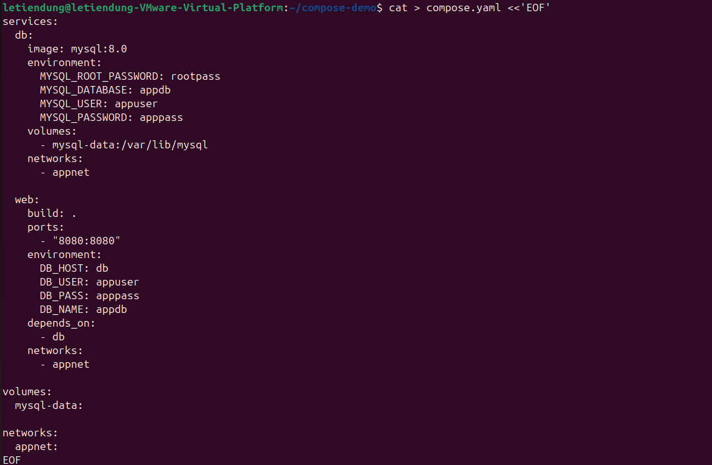
**4. Khởi động và kiểm tra:**

```bash
docker compose config           # kiểm tra cú pháp
docker compose up -d --build    # build và chạy
docker compose ps               # xem trạng thái
docker compose logs -f web      # xem log web
```
>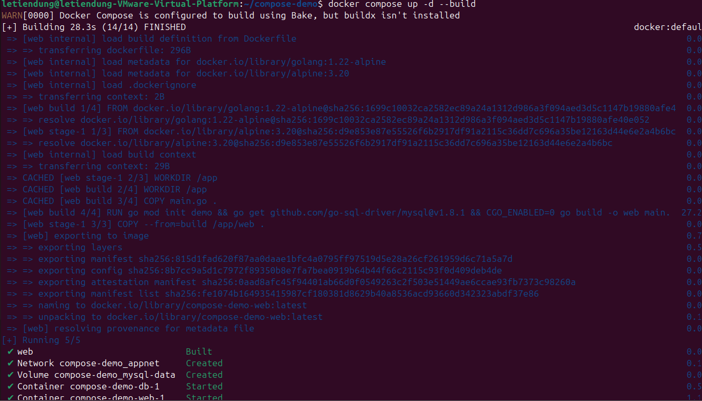
>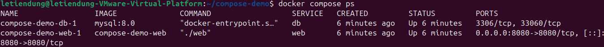
>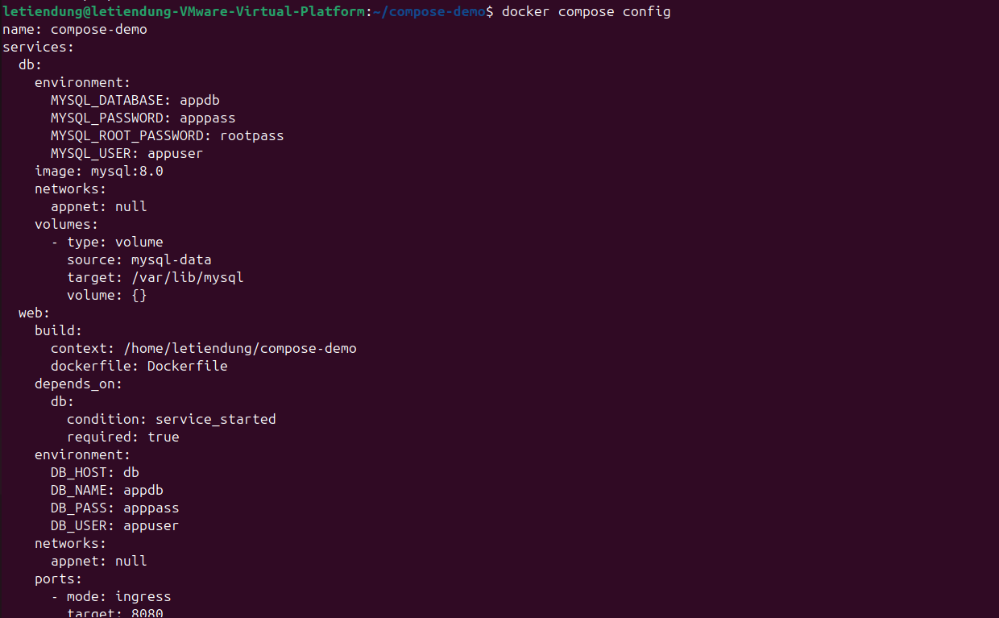
>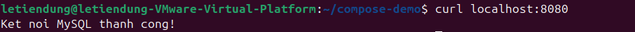

**5. Xử lý lỗi thường gặp:**

| Lỗi | Cách kiểm tra |
|---|---|
| Web không kết nối được DB | `docker compose logs db`, kiểm tra biến môi trường trong `compose.yaml` |
| Port đã bị chiếm | Đổi cổng host, ví dụ `"5001:5000"` |
| DB khởi động chậm | Kiểm tra `healthcheck`, tăng `retries` |

**6. Dừng và triển khai lại toàn bộ:**

```bash
docker compose down             
docker compose down -v          
docker compose up -d --build    
```
>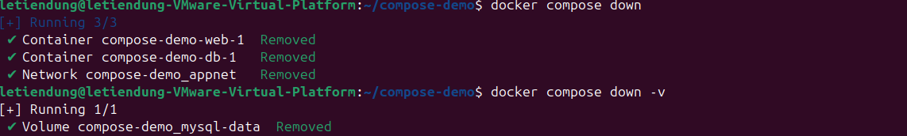